# 공약추적기 (PledgeTracker)

*Every campaign promise, tracked one by one — with the source to prove it.*

당선된 사람이 선거 때 약속한 공약 하나하나가 지금 지켜지고 있는지를, 확인할 수 있는 출처와 함께 보여 주는 웹 서비스입니다. 선거관리위원회에 올라온 공약서를 공약 단위로 나누고, 정부·시도의 공식 보도자료에서 찾은 근거를 붙여 "미착수 / 진행 중 / 이행 / 변경 / 폐기"로 정리합니다. 판단은 보는 사람이 근거 링크를 직접 열어 보고 하면 됩니다.

**라이브 데모**: <!-- DEMO_URL -->[https://pledgetracker-1072416881206.asia-northeast3.run.app](https://pledgetracker-1072416881206.asia-northeast3.run.app) (로그인 없이 둘러볼 수 있습니다)

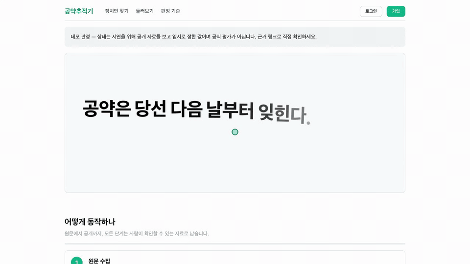

<table>
  <tr>
    <td width="75%">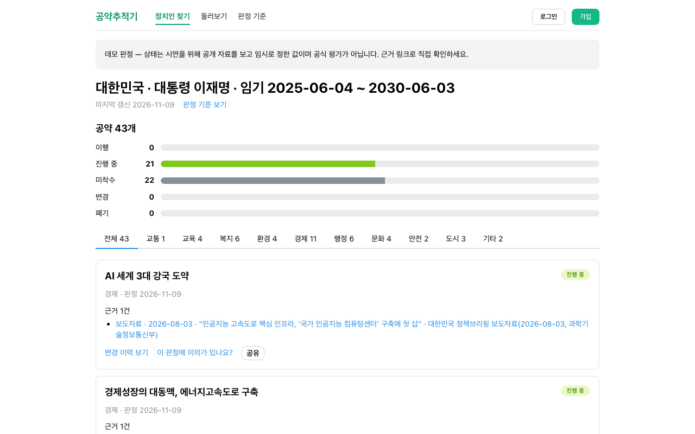</td>
    <td width="25%">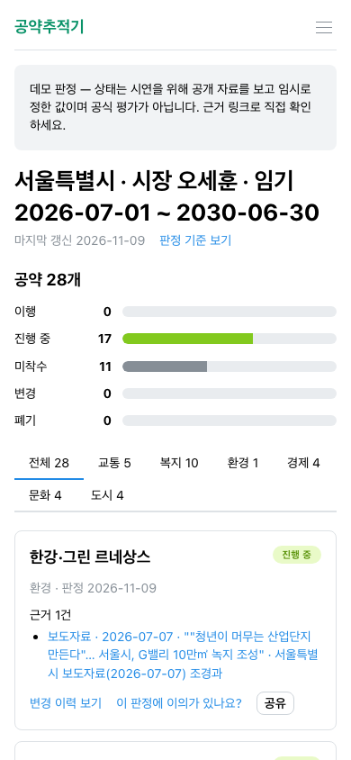</td>
  </tr>
  <tr>
    <td align="center">한 사람의 공약 전부를 한 화면에 (데스크톱)</td>
    <td align="center">휴대폰에서도 같은 화면</td>
  </tr>
</table>

> **데모 판정 고지** — 화면의 상태는 시연을 위해 공개 자료(정부·시도 보도자료)를 보고 임시로 정한 **데모 판정**이며 공식 평가가 아닙니다. 모든 상태 옆의 근거 링크로 직접 확인하세요.

---

## 왜 만들었나

### 철학
공약은 당선 다음 날부터 잊힌다. 잊지 않는 것만으로도 정치는 조금 달라진다.

### 문제
- 선거 때 수십 개 공약이 쏟아지지만 임기 중 이행 여부를 추적하는 곳이 없다
- 언론은 큰 공약 몇 개만 다루고, 지역 공약은 아무도 안 본다
- 유권자는 다음 선거 때 "뭘 약속했었지"조차 기억 못 한다

### 그래서 이렇게 했습니다
- 선관위 공약집·공보물을 받아 공약을 **항목 하나씩** 나눕니다.
- 각 공약에 "미착수 / 진행 중 / 이행 / 변경 / 폐기" 상태와 **근거 링크**를 붙입니다.
- 근거 후보는 보도자료에서 자동으로 모으지만, **최종 판정은 사람이 검수**합니다.
- 정파적 해석은 넣지 않고 **사실과 출처만** 보여 줍니다.

---

## 이런 분께

<table>
  <tr>
    <td width="33%" valign="top">
      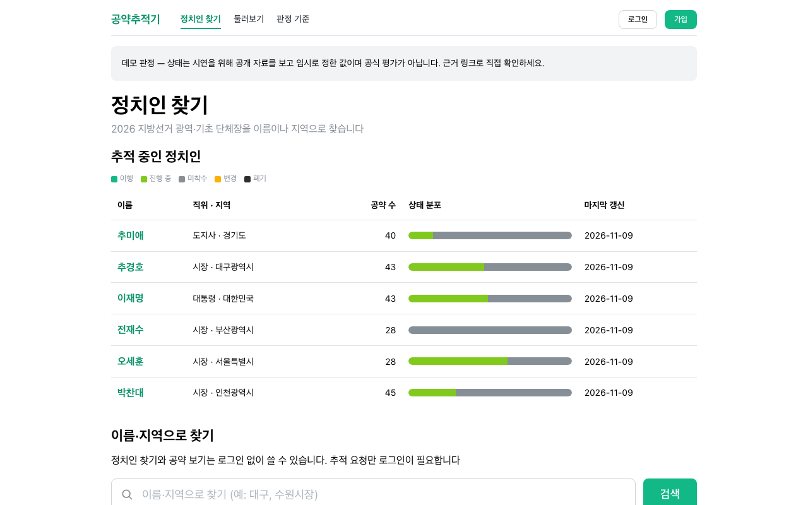
      <p><b>지역 주민 (유권자)</b><br>공보물은 이미 버렸고 다음 선거가 다가옵니다. "뭘 약속했고 뭐가 됐나"를 5분 안에 봅니다. 가입도 로그인도 필요 없습니다.</p>
    </td>
    <td width="33%" valign="top">
      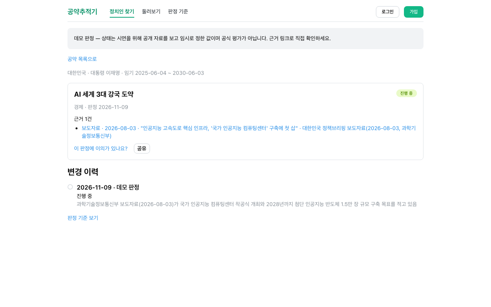
      <p><b>지역 언론 기자</b><br>작은 지역 공약까지 이행 여부를 출처와 함께 인용합니다. 공약마다 고정 주소(공유 버튼)와 변경 이력이 있습니다.</p>
    </td>
    <td width="33%" valign="top">
      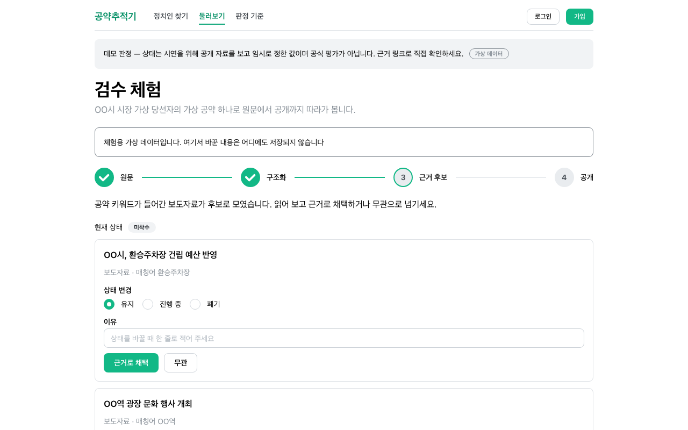
      <p><b>검수자 (운영자)</b><br>모인 근거 후보를 읽고 채택하거나 넘깁니다. 상태를 바꿀 때는 이유 한 줄이 꼭 남아, 판정 과정이 투명하게 기록됩니다.</p>
    </td>
  </tr>
</table>

---

## 3분 사용법

### 1. 소개 페이지에서 시작합니다
첫 화면은 공약추적기를 소개하는 페이지입니다. 아래로 내리면 공약 하나가 공개되기까지의 다섯 단계(원문 수집 → 공약 구조화 → 근거 수집 → 사람 검수 → 공개)가 차례로 켜지고, 지금까지 모은 자료의 숫자가 나옵니다.

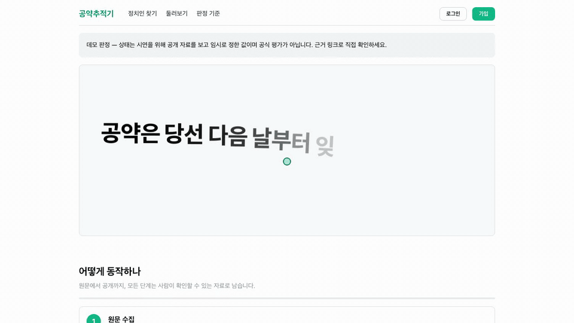

| 첫 화면 | 다섯 단계 | 지금까지 모은 자료 | 휴대폰 |
|---|---|---|---|
| 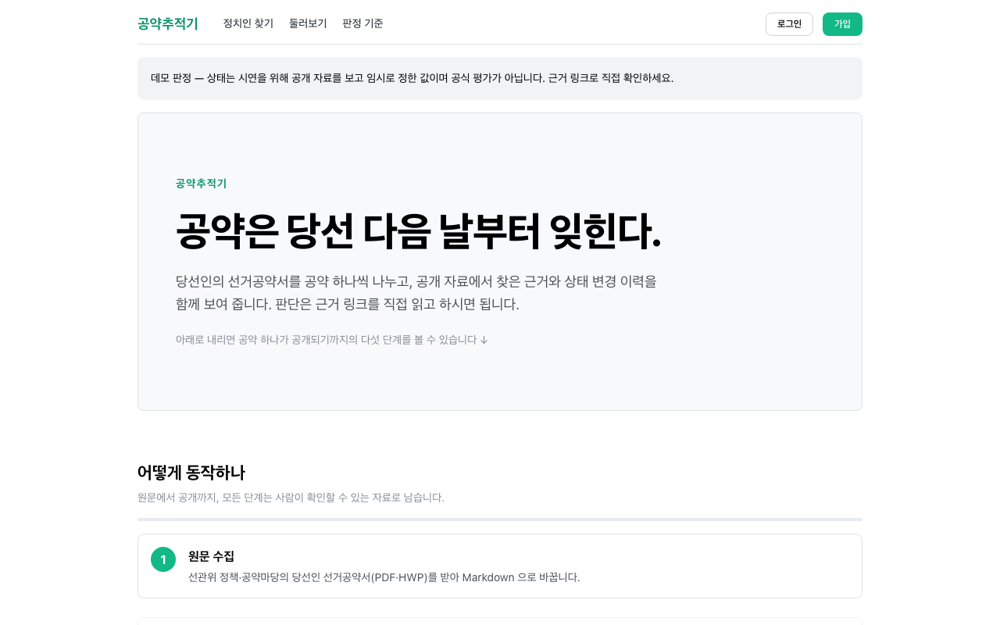 | 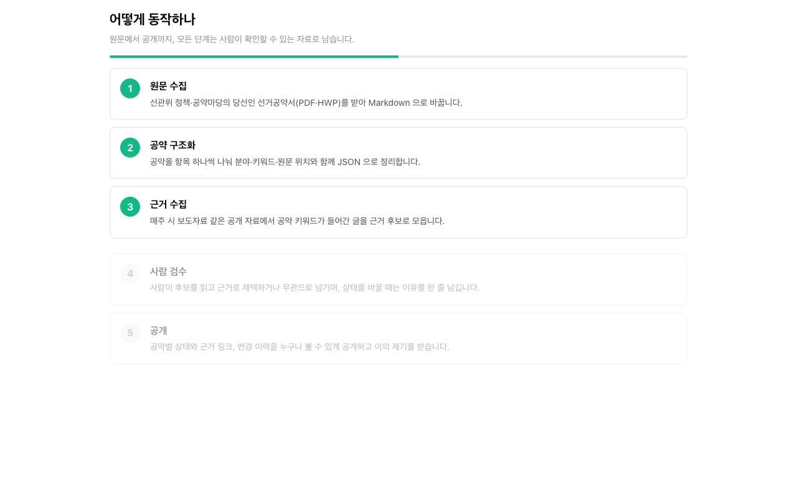 | 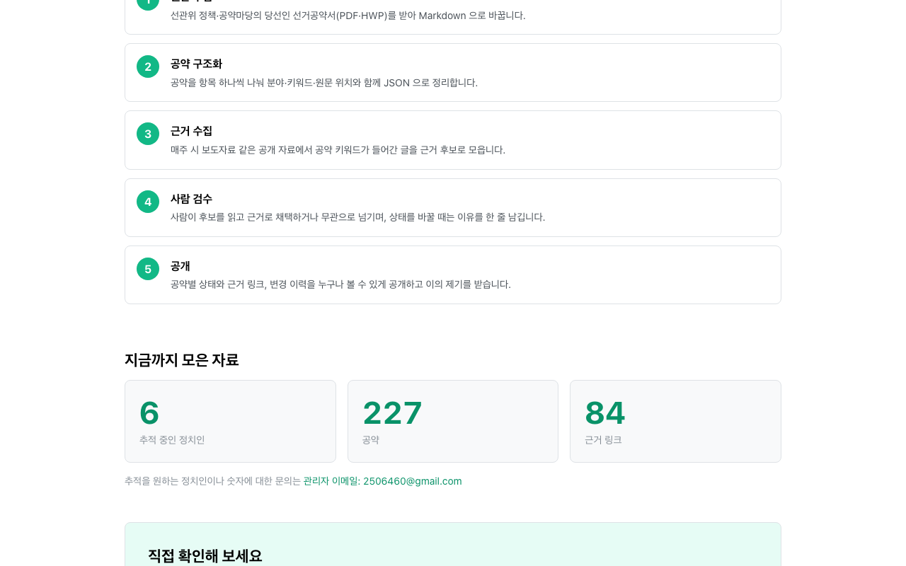 | 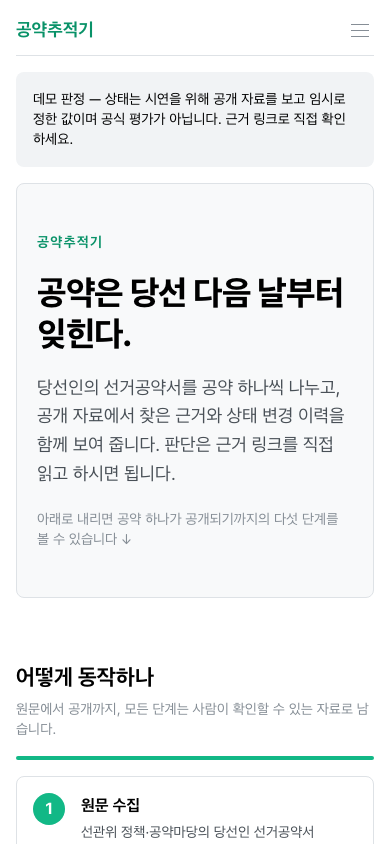 |

### 2. "정치인 찾기"에서 사람을 고릅니다
맨 위 **추적 중인 정치인** 표에 공약 데이터가 있는 사람이 모여 있습니다. 막대 하나로 상태 분포를 한눈에 보고, 이름을 누르면 그 사람의 대시보드가 열립니다. 아래 검색창에 이름이나 지역(예: "대구")을 적으면 2026 지방선거 당선자 243명 중에서 찾아 줍니다.

| 추적 중인 정치인 표 | "대구"로 찾은 결과와 필터 | 휴대폰 |
|---|---|---|
|  | 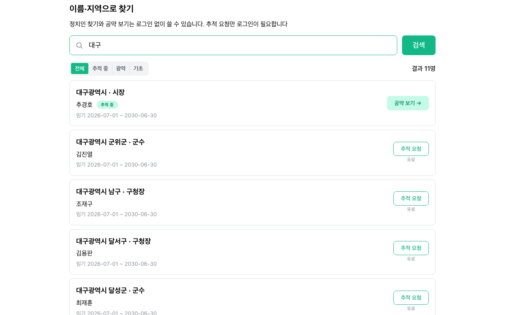 | 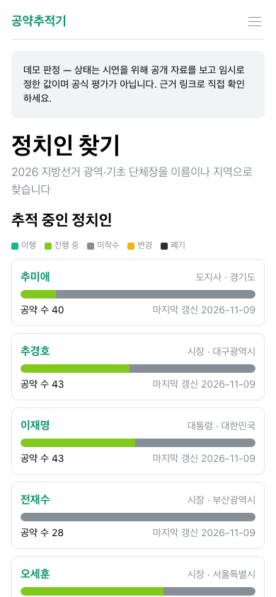 |

### 3. 대시보드에서 전체를 훑습니다
공약 수, 상태별 숫자와 막대, 분야 탭(경제·복지·교통…)이 있습니다. 막대를 누르면 그 상태의 공약만, 탭을 누르면 그 분야만 보입니다. 카드마다 상태·판정일·근거 링크가 붙어 있습니다.


### 4. 근거를 직접 확인합니다
카드의 근거 링크를 누르면 원문 보도자료가 열립니다. "변경 이력 보기"에서는 언제 어떤 근거로 상태가 정해졌는지 볼 수 있고, "판정 기준"에는 다섯 상태의 정의와 규칙이 있습니다.

| 공약 상세와 변경 이력 | 판정 기준 |
|---|---|
|  | 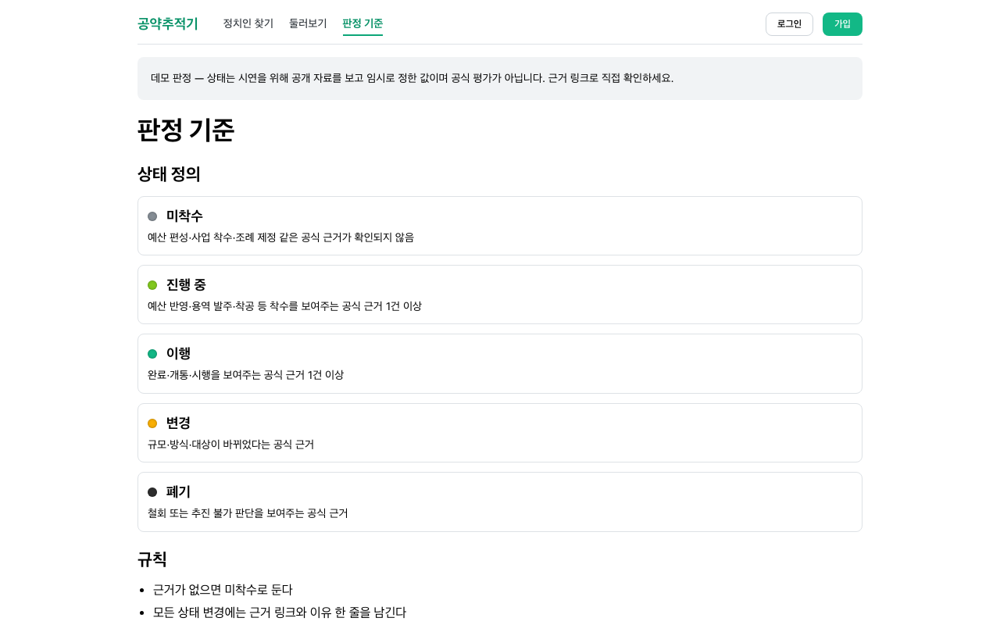 |

### 5. 판정이 틀렸다면 이의를 보냅니다
카드의 "이 판정에 이의가 있나요?"를 누르면 누구나 내용과 근거 링크를 보낼 수 있습니다. 이름이나 연락처는 받지 않습니다. 검수자가 확인한 결과는 변경 이력에 남습니다.

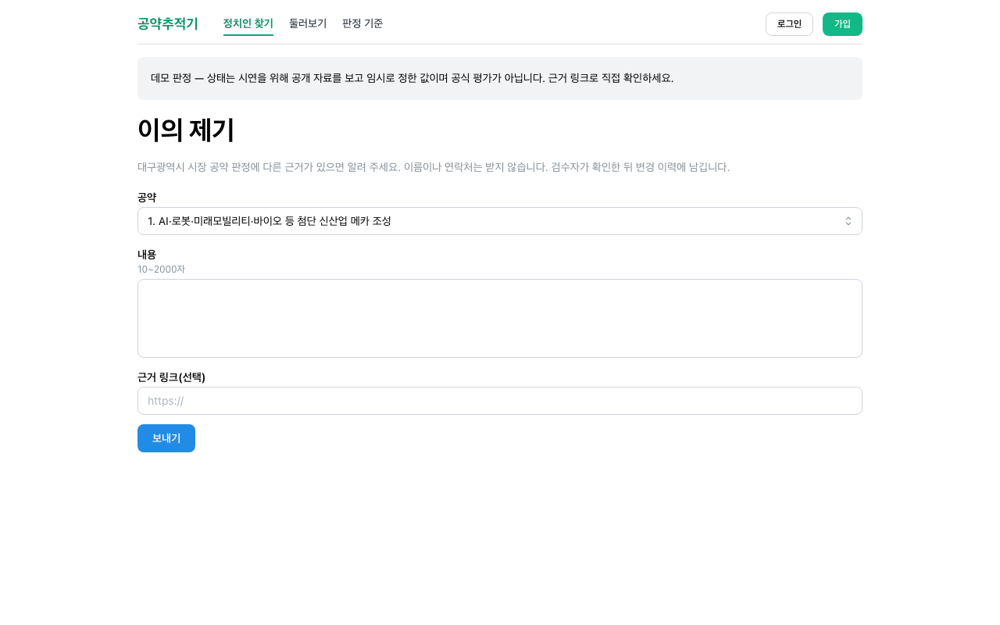

### 6. 검수가 어떻게 이뤄지는지 체험해 봅니다
메뉴의 **둘러보기**에서 가상 공약 하나로 원문 → 구조화 → 근거 후보 검수 → 공개 과정을 직접 해 볼 수 있습니다. 브라우저 안에서만 돌고 어디에도 저장되지 않습니다.

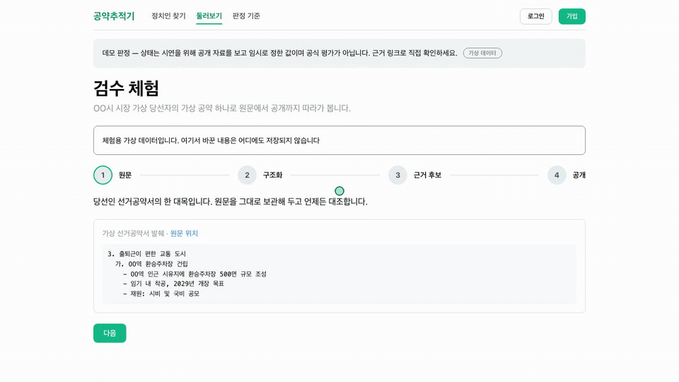

| 근거 후보 채택 | 공개 결과와 이력 |
|---|---|
|  | 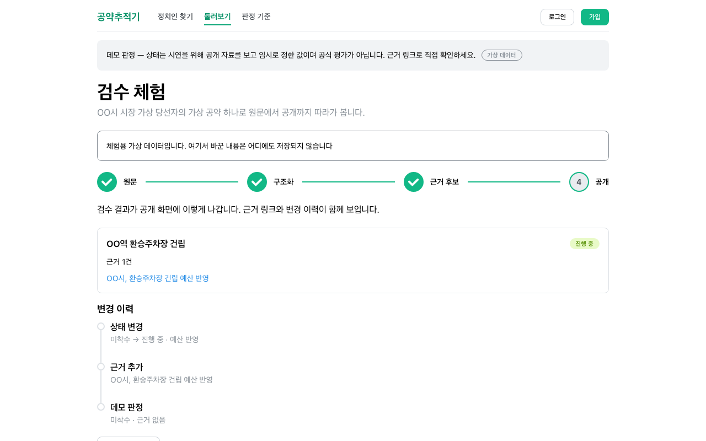 |

### 7. 아직 없는 사람은 "추적 요청" (로그인 필요)
검색 결과에 "추적 중"이 아닌 사람은 **추적 요청** 버튼이 있습니다. 로그인이 필요한 기능은 이것 하나뿐입니다. 로그인하지 않았다면 안내 창이 뜨고, 로그인·가입하면 같은 요청으로 돌아옵니다. 회원에게는 관리자 문의 안내가 나옵니다(요청은 저장하지 않습니다, 결제 없음).

| 로그인 안내 | 휴대폰 메뉴 | 검수 화면 (검수자 전용 로그인) |
|---|---|---|
| 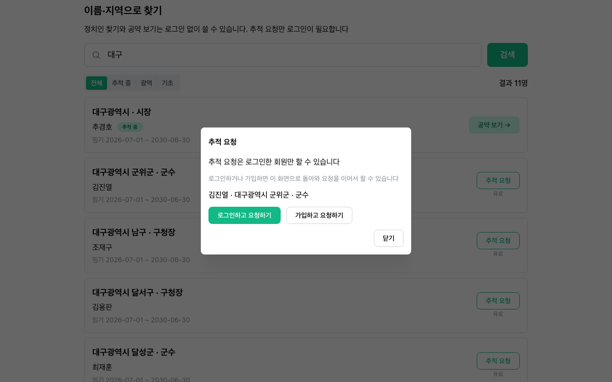 | 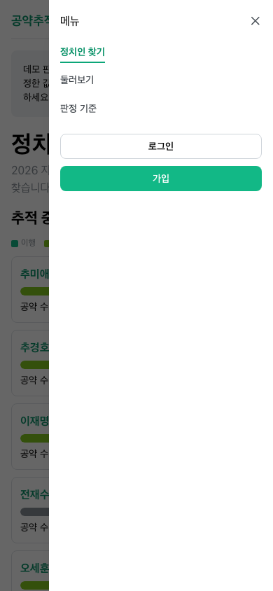 | 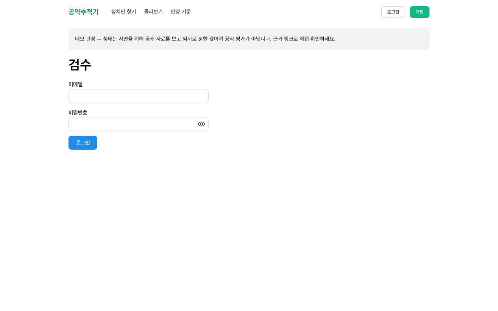 |

### 누가 무엇을 할 수 있나

| 할 수 있는 것 | 비회원 | 회원 | 검수자 |
|---|:-:|:-:|:-:|
| 소개, 정치인 찾기·검색, 대시보드, 공약 상세·변경 이력, 판정 기준 | O | O | O |
| 이의 제기 보내기 | O | O | O |
| 검수 체험 (가상 데이터, 저장 안 됨) | O | O | O |
| 추적 요청 (관리자 문의 안내, 저장 안 됨) | 로그인 안내 | O | O |
| 근거 후보 채택·상태 변경·이의 처리 | - | - | O |

---

## 어떻게 판정하나

| 상태 | 뜻 |
|---|---|
| 미착수 | 예산 편성·사업 착수·조례 제정 같은 공식 근거가 확인되지 않음 |
| 진행 중 | 예산 반영·용역 발주·착공 등 착수를 보여 주는 공식 근거 1건 이상 |
| 이행 | 완료·개통·시행을 보여 주는 공식 근거 1건 이상 |
| 변경 | 규모·방식·대상이 바뀌었다는 공식 근거 |
| 폐기 | 철회 또는 추진 불가 판단을 보여 주는 공식 근거 |

- **근거가 없으면 미착수로 둡니다.** 모든 상태 변경에는 근거 링크와 이유 한 줄을 남깁니다.
- **근거 출처는 공식 보도자료**입니다. 대통령은 대한민국 정책브리핑의 부처 보도자료, 시·도지사는 각 시·도 누리집 보도자료를 봤습니다. 예산 반영·용역 착수·공모 선정·지정·공식 절차 제출·시행일 확정 같은 사실이 있으면 진행 중, 행사·간담회·건의만 있으면 미착수입니다.
- **중립 원칙**: 정당·득표율·기호는 수집하지 않습니다(데이터 스키마가 정당 필드를 거부합니다). 공약의 좋고 나쁨을 말하는 문구는 화면 어디에도 없습니다. 대상은 정당이 아니라 행정표준코드 순서와 인구 순위로 골랐습니다.
- 지금 화면의 판정은 모두 **데모 판정**입니다. 모든 화면 머리에 같은 고지가 붙습니다.

---

## 추적 중인 정치인

여섯 명, 공약 **227개**, 근거 링크 **84건**. 판정 기준일은 2026-11-08, 근거 링크는 모두 2026-11-09 에 열어 응답을 확인했습니다.

| 대상 | 공약 수 | 진행 중 | 미착수 | 이행·변경·폐기 | 근거 링크 | 대시보드 |
|---|--:|--:|--:|--:|--:|---|
| 제21대 대통령 | 43 | 21 | 22 | 0 | 25 | [열기](https://pledgetracker-1072416881206.asia-northeast3.run.app/o/president-2025) |
| 서울특별시장 당선자 | 28 | 17 | 11 | 0 | 18 | [열기](https://pledgetracker-1072416881206.asia-northeast3.run.app/o/seoul-mayor-2026) |
| 부산광역시장 당선자 | 28 | 0 | 28 | 0 | 0 | [열기](https://pledgetracker-1072416881206.asia-northeast3.run.app/o/busan-mayor-2026) |
| 대구광역시장 당선자 | 43 | 20 | 23 | 0 | 21 | [열기](https://pledgetracker-1072416881206.asia-northeast3.run.app/o/daegu-mayor-2026) |
| 인천광역시장 당선자 | 45 | 13 | 32 | 0 | 14 | [열기](https://pledgetracker-1072416881206.asia-northeast3.run.app/o/incheon-mayor-2026) |
| 경기도지사 당선자 | 40 | 6 | 34 | 0 | 6 | [열기](https://pledgetracker-1072416881206.asia-northeast3.run.app/o/gyeonggi-governor-2026) |
| **합계** | **227** | **77** | **150** | **0** | **84** | |

- 부산광역시장 당선자: 판정 작업을 한 환경에서 시 공식 누리집 전체가 보안 차단(HTTP 401)을 돌려줬고 차단은 우회하지 않았습니다. 그래서 28개 모두 미착수 "근거 미확인 (검토 범위 밖)"입니다.
- 제21대 대통령은 검색(2026 지방선거 당선자 목록)에는 나오지 않고, 정치인 찾기 위 "추적 중인 정치인" 표에서 엽니다.

<details>
<summary>원문 출처와 데이터 기준 펼치기</summary>

- 원문은 모두 중앙선거관리위원회 정책·공약마당 당선인 공약 화면(https://policy.nec.go.kr/plc/commiment/initUELCommiment.do?menuId=WINNR2)에서 받았습니다. 선거공약서가 등록되지 않은 경기·서울·부산은 같은 화면의 선거공보를 썼습니다. 메타(받은 날·sha256)는 `data/sources/<id>.meta.json`.
  - 제21대 대통령 선거공약서 PDF (16쪽): https://policy.nec.go.kr/plc/common/downloadFile.do?requestedFileName=20250603_doc.pdf&requestedFullPath=20250603/PDF/PRMS_DOC_PUB/1/004_100153692_20250516_1.pdf
  - 대구광역시 시장 당선자 선거공약서 PDF (16쪽): https://policy.nec.go.kr/plc/common/downloadFile.do?requestedFileName=20260603_doc.pdf&requestedFullPath=20260603/PDF/PRMS_DOC_PUB/2700/004_100163199_20260526_1.pdf
  - 경기도 도지사 당선자 선거공보 PDF (11쪽): https://policy.nec.go.kr/plc/common/downloadFile.do?requestedFileName=20260603_doc.pdf&requestedFullPath=20260603/PDF/PBINFO_PUB/4100/003_100163148_20260526_3.pdf
  - 서울특별시 시장 당선자 선거공보 PDF (11쪽): https://policy.nec.go.kr/plc/common/downloadFile.do?requestedFileName=20260603_doc.pdf&requestedFullPath=20260603/PDF/PBINFO_PUB/1100/003_100162984_20260526_2.pdf
  - 부산광역시 시장 당선자 선거공보 PDF (11쪽): https://policy.nec.go.kr/plc/common/downloadFile.do?requestedFileName=20260603_doc.pdf&requestedFullPath=20260603/PDF/PBINFO_PUB/2600/003_100163192_20260526_2.pdf
  - 인천광역시 시장 당선자 선거공약서 PDF (12쪽): https://policy.nec.go.kr/plc/common/downloadFile.do?requestedFileName=20260603_doc.pdf&requestedFullPath=20260603/PDF/PRMS_DOC_PUB/2800/004_100163128_20260521_1.pdf
- 첫 대상(대구)은 행정표준코드 순으로 "문서 다운로드 가능 + 공약 15~80개 + 텍스트 레이어 있음"을 처음 만족한 곳이고, 정당은 보지 않았습니다. 이어서 제21대 대통령과 인구 상위 4개 광역(경기·서울·부산·인천) 단체장 당선자를 같은 방식으로 넣었습니다.
- 공약 단위: 핵심공약 아래 "•" 항목 하나 = 공약 하나. 분야별 세부와 요약 쪽은 앞 내용과 겹쳐 뺐습니다.
- 대구 데이터셋은 `data/pledges/`, 나머지 다섯은 `data/pledges-extra/<id>.json` 에 있습니다(E2E 가 `data/pledges/` 의 파일 하나를 기준으로 씁니다).
- 당선자 목록(정치인 찾기): `data/catalog/officials-2026.json`, 같은 선관위 화면의 시·도지사와 구·시·군의 장 당선인 목록. 광역 **16명** · 기초 **227명**, 모두 243명. 제9회 지방선거에서는 광주광역시와 전라남도가 `전남광주통합특별시` 하나로 선거를 치러 광역이 16곳입니다. 세종·제주는 기초단체장 선거가 없습니다. 임기는 출처에 다른 값이 없어 모두 2026-07-01 ~ 2030-06-30 입니다. 항목마다 `source_url` 을 남깁니다.

</details>

---

## 어떻게 만들었나

<details>
<summary>개발자용: 아키텍처 · 기술 선택 · 품질 · 보안 · 실행 방법 · 배포 펼치기</summary>

### 아키텍처

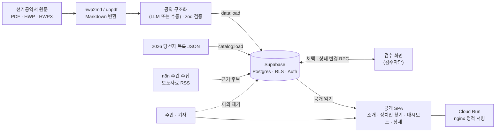

- 공개 화면은 읽기만 합니다. 상태 변경과 이력 기록은 DB 함수(RPC) 하나가 한 트랜잭션으로 처리해 둘이 어긋나지 않습니다.
- 근거 수집은 후보까지만 자동입니다. 채택과 상태 판정은 항상 검수자가 합니다.
- n8n 수집과 공약 추출은 로컬 운영 도구이고, 공개 서버에는 웹 화면(정적 파일)만 올라갑니다.

### 기술 선택

직접 만들지 않고 검증된 오픈소스·관리형 서비스를 골랐습니다.

| 필요 | 선택 | 왜 |
|---|---|---|
| DB·REST·권한 | Supabase (Postgres + PostgREST + RLS) | 조회 API·권한을 서버 코드 없이 설정으로 끝냄 |
| 로그인 | Supabase Auth (email/password) | 세션·비밀번호 해시를 직접 다루지 않음 |
| 상태+이력 동시 기록 | Postgres `security definer` 함수 | 브라우저가 여러 행을 차례로 쓰다 중간에 실패하는 일을 없앰 |
| 주간 근거 수집 | n8n (Schedule · RSS Read · HTTP · Code 노드) | RSS 파서·스케줄러를 만들지 않고, 실행 기록을 화면에서 봄 |
| HWP/HWPX → Markdown | hwp2md | HWP·HWPX 를 모두 Markdown 으로 바꾸는 CLI |
| PDF 텍스트 | unpdf | pdfjs 를 감싼 얇은 API, 워커·폰트 설정 불필요 |
| 공약 추출 | `openai` SDK (OpenAI 호환 API, baseURL 교체) | 재시도·타임아웃을 SDK 에 맡김 |
| 스키마 검증 | zod | 스키마에서 TS 타입을 바로 얻음 |
| 화면 | Vite + React + Mantine | 막대·탭·카드·타임라인이 Mantine core 에 모두 있음 |
| 소개 애니메이션 | GSAP ScrollTrigger | 스크롤 고정·단계 켜짐을 검증된 도구로 (동작 줄이기 설정 존중) |
| 테스트 | Vitest · pgTAP · Playwright | 단위·DB 권한·브라우저 흐름을 각각 |
| 린트·포맷 | Biome | 한 도구로 린트·포맷·import 정렬 |
| 배포 | Cloud Run + nginx-unprivileged | 요청이 없으면 비용이 거의 0, 비루트 컨테이너 |

TypeScript 하나로 웹·스크립트·테스트를 쓰고, Node 24 의 타입 제거 실행으로 스크립트를 빌드 없이 돌립니다.

### 품질

| 종류 | 수 | 무엇을 보나 |
|---|--:|---|
| 단위 테스트 (Vitest) | 122 (13 파일) | 데이터셋 스키마·금지어, 키워드 매칭, 상태 전이, 검색·요청 복귀, 체험 reducer |
| DB 권한 테스트 (pgTAP) | 60 | 비회원·회원·검수자별 읽기/쓰기, RPC 권한과 오류 |
| E2E (Playwright, 실제 로컬 Supabase) | 106 (19 파일) | 소개·검색·대시보드·상세·이의 제기·검수·체험·로그인 복귀·모바일 메뉴 |

`main` 에 push 하면 CI 가 린트·타입 검사·단위 테스트·빌드·E2E 를 돌리고, 통과하면 자동 배포합니다.

### 보안

- **비회원 공개 범위**: 비회원은 공개 테이블 읽기와 이의 제기 보내기만 할 수 있습니다. 이의 제기 본문과 근거 후보는 공개 화면에 보이지 않고, 처리 결과(근거·변경 이력)만 공개됩니다.
- **RLS**: 8개 테이블 모두 행 수준 보안을 켰습니다. 쓰기는 service role 과 검수자 확인을 거치는 DB 함수로만 합니다. 가입한 회원은 검수 권한이 없습니다(검수자는 별도 명령으로만 등록).
- **열린 리다이렉트 차단**: 로그인·가입 뒤 돌아갈 주소(`next`)는 이 사이트 안의 경로만 받습니다.
- 공개 서버에는 비밀이 없습니다. 브라우저에 들어가는 값은 Supabase 공개(anon) 키뿐이고, service_role 키는 데이터 적재에만 씁니다.

### 로컬 실행

#### 준비물
- Node.js 24 이상 (`.ts` 스크립트를 빌드 없이 바로 실행한다)
- Docker (로컬 Supabase 와 n8n 이 컨테이너로 돈다)
- Supabase CLI (`supabase`)
- uv (`uvx` 로 hwp2md 를 부른다. 공약집 변환을 다시 할 때만 필요)

#### 순서
아래 명령은 모두 이 저장소 폴더 안에서 실행한다. 상위 폴더에서 실행하면 `package.json`·`supabase/` 를 찾지 못해 실패한다.
```bash
# 0. 저장소 폴더로 이동
cd pledgetracker

# 1. 설치
npm ci
npx playwright install chromium

# 2. 로컬 Supabase 시작 (마이그레이션 적용, API http://localhost:58321)
supabase start

# 3. 공약 데이터 넣기 (여러 번 실행해도 행 수가 같다)
npm run data:load -- data/pledges/daegu-mayor-2026.json
for f in data/pledges-extra/*.json; do npm run data:load -- "$f"; done
#   가상 샘플('OO시')만 보려면: npm run data:load -- tests/fixtures/dataset.sample.json

# 4. 2026 당선자 목록 넣기 (정치인 찾기 화면이 쓴다. 여러 번 실행해도 행 수가 같다)
npm run catalog:load -- data/catalog/officials-2026.json
#   검증만 하려면: node --no-warnings=ExperimentalWarning scripts/load-catalog.ts data/catalog/officials-2026.json --check

# 5. 웹 실행 → http://localhost:8860 (첫 화면은 소개 페이지)
npm run dev

# 6. 계정
#   정치인 찾기·대시보드는 로그인 없이 쓴다
#   회원: 추적 요청을 누르면 로그인 안내가 뜬다. /signup 에서 이메일·비밀번호(6자 이상)로 가입하면 같은 요청으로 돌아온다
#   검수자: 아래 명령으로 만든다 (가입한 회원은 검수 권한이 없다) → /review 에서 로그인
npm run create-reviewer -- --email reviewer@example.com --password '<비밀번호>'

# 7. n8n 띄우기 (편집기 http://localhost:8862)
npm run build:workflow
npm run n8n:up

# 8. 테스트 (LLM 키 없이 fixture 모드로 돈다)
npx vitest run
supabase test db
scripts/sb-env.sh npx playwright test
```

#### 접속값과 `.env`
- Supabase URL·키는 파일에 저장하지 않는다. `scripts/sb-env.sh <명령>` 이 실행할 때마다 `supabase status -o env` 에서 읽어 환경변수로 넣는다. `npm run dev`·`data:load`·`catalog:load`·`create-reviewer`·`n8n:up`·`e2e` 는 이미 이 래퍼를 거친다.
- 같은 래퍼가 기본 지자체(`daegu-mayor-2026`)와 근거 RSS 주소(`EVIDENCE_FEED_URLS`)도 넣는다. 다른 값을 쓰려면 환경변수로 덮어쓴다.
- `.env` 는 LLM 키 전용이며 **없어도 된다**. `LLM_BASE_URL`·`LLM_API_KEY`·`LLM_MODEL`(OpenAI 호환 API)을 넣으면 공약 추출과 근거 후보 메모를 LLM 으로 만든다. 없으면 추출은 수동 구조화, 메모는 비워 두고, 테스트는 `LLM_MODE=fixture` 로 디스크의 응답 파일만 쓴다.

#### 공약집을 다시 변환할 때
```bash
node scripts/parse-doc.ts data/raw/daegu-mayor-2026.pdf --out data/raw/md
node scripts/extract-pledges.ts --in data/raw/md/daegu-mayor-2026.md --official daegu-mayor-2026 \
  --source-url "<원문 URL>" --official-meta data/sources/daegu-mayor-2026.meta.json --out data/pledges/daegu-mayor-2026.json
npm run data:validate -- data/pledges/daegu-mayor-2026.json
```
원문 PDF(`data/raw/`)는 저장소에 넣지 않는다. 위 출처 URL 에서 받고 메타 파일의 sha256 으로 같은 문서인지 확인한다.

### 배포 (Cloud Run)

공개 데모: https://pledgetracker-1072416881206.asia-northeast3.run.app

n8n 수집·LLM 추출은 로컬 운영 도구이며 배포하지 않는다. 공개 서버에는 웹 화면(정적 파일)만 올라가고, 데이터는 호스팅 Supabase 에 있다.

#### 구성
- 웹: Vite 빌드 결과를 `nginxinc/nginx-unprivileged` 컨테이너(비루트, 포트 8080)가 정적으로 서빙한다. 새로고침해도 화면이 나오도록 없는 경로는 `index.html` 로 돌리고, 빌드 자원 폴더의 없는 파일은 404, `GET /health` 는 `{"ok":true}`. 설정은 `deploy/nginx/default.conf`, 이미지는 `Dockerfile`.
- Supabase 주소·공개(anon) 키는 빌드 인자 `VITE_SUPABASE_URL`·`VITE_SUPABASE_ANON_KEY` 로 번들에 들어간다(브라우저에 보이는 공개 값). 서버에 비밀이 없어 Secret Manager 를 쓰지 않는다.
- DB·Auth: 호스팅 Supabase(서울 리전, 무료). 마이그레이션은 로컬과 같은 `supabase/migrations/*`.
- GCP: Cloud Run 서비스 `pledgetracker`(asia-northeast3), Artifact Registry 저장소 `pledgetracker`, 실행 SA `pledgetracker-run`(역할 없음), 배포 SA `pledgetracker-deploy`, GitHub OIDC(Workload Identity Federation, `main` 브랜치만). 키 파일은 만들지 않는다.

#### 운영 값 파일
`deploy/env.production.example` 을 `.env.production` 으로 복사해 Supabase 주소와 키를 채운다(키 위치는 파일 주석). `.env.production` 은 커밋되지 않고, 아래 스크립트가 직접 읽는다. service_role 키는 데이터 적재에만 쓰고 GitHub·Cloud Run 에 올리지 않는다.

#### 첫 배포 순서
```bash
# 1. GCP 자원·IAM (API·Artifact Registry·서비스 계정·WIF. 여러 번 돌려도 된다)
GCP_PROJECT_ID=illy-portfolio GCP_REGION=asia-northeast3 GITHUB_REPO=ilyos-numon/pledgetracker bash deploy/gcp/setup.sh
#    확인: 같은 명령에 --verify → 마지막 줄 SETUP OK

# 2. 운영 DB 이전 (아래 "운영 DB 이전")
# 3. 운영 데이터 적재 (공약 6명 + 2026 당선자 목록. 여러 번 돌려도 행 수가 같다) → 마지막 줄 LOAD OK officials=6 catalog=<N>
bash deploy/load-prod.sh
#    검수자 계정: bash deploy/load-prod.sh --reviewer-email <이메일>   (비밀번호는 화면에 보이지 않게 입력)

# 4. GitHub Actions Variables 7개 (값은 출력하지 않는다) → GH VARS OK 7
GH_TOKEN=$(gh auth token) bash deploy/gcp/gh-vars.sh

# 5. 첫 이미지(:bootstrap) 빌드·push → IMAGE=...:bootstrap
bash deploy/gcp/push-image.sh

# 6. Cloud Run 서비스 생성 (deploy/gcp/service.yaml 렌더 → services replace → /health 확인) → APPLY OK
GCP_PROJECT_ID=illy-portfolio IMAGE=asia-northeast3-docker.pkg.dev/illy-portfolio/pledgetracker/pledgetracker:bootstrap \
  bash deploy/gcp/apply-env.sh
```
모든 스크립트는 `--dry-run` 으로 실행할 명령만 먼저 볼 수 있다.

#### 자동 배포
- `main` 에 push 하면 `ci` 워크플로(lint·타입 검사·단위 테스트·빌드·로컬 Supabase E2E)가 돌고, 성공하면 `deploy` 워크플로가 커밋 SHA 태그로 이미지를 빌드해 같은 서비스의 이미지만 바꾼다. `:bootstrap` 이미지는 첫 자동 배포가 교체한다.
- `deploy` 는 이미지 입력 파일(웹 코드·빌드 설정·nginx 설정)이 바뀌었을 때만 이미지를 새로 만든다. Supabase 주소나 공개 키(GitHub Variables)만 바꿨다면 `deploy` 워크플로를 force 로 수동 실행한다.

#### 운영 DB 이전
```bash
supabase link --project-ref <SUPABASE_REF>   # DB 비밀번호 입력
supabase db push                             # 마이그레이션 적용
supabase migration list                      # Local·Remote 열이 같은지 확인
```
직접 연결이 IPv6 로 실패하면 대시보드 Connect 의 Session pooler 주소를 `supabase db push --db-url '<주소>'` 로 준다. Auth 설정(대시보드 Authentication): Site URL 과 Redirect URLs 에 공개 주소를 넣고, 이메일 가입을 켜고 이메일 확인은 끈다(무료 메일 발송 한도로 가입이 막히지 않게). 남용 방지는 Supabase 기본 가입 속도 제한과, 회원 권한이 추적 요청 안내뿐이라는 점으로 대신한다.

#### keepalive
무료 Supabase 는 오래 요청이 없으면 일시정지된다. `keepalive` 워크플로가 3일마다 공개 키로 REST 를 한 번 읽는다.

#### 비용 상한
- Cloud Run 은 최소 인스턴스 0, 최대 1(cpu 1, 512Mi). 요청이 없으면 비용이 거의 0 이다.
- Artifact Registry 는 정리 정책으로 최신 이미지 2개만 남긴다.
- 월 10,000원 예산 알림(50·90·100%)을 건다.

</details>

---

## 하지 않는 것
- 공약의 좋고 나쁨 평가
- 특정 정당·후보 편향 노출

## 한계

- **모두 데모 판정입니다.** 공개 자료를 보고 임시로 정한 값이며 공식 평가가 아닙니다.
- **근거 범위가 좁습니다.** 공식 보도자료만 봤습니다. 의회 회의록·예산서·언론 보도는 아직 보지 않아, 보도자료에 없는 진행 사항은 미착수로 남습니다. 경기는 제목 검색, 대통령은 검색 결과 첫 쪽만 봐서 놓친 사실이 있을 수 있습니다.
- **부산은 판정하지 못했습니다.** 시 공식 누리집이 작업 환경에서 보안 차단을 돌려줬고 우회하지 않았습니다. 다른 출처로 넓히려면 판정 규칙을 바꾸는 결정이 먼저 필요합니다.
- **이행·변경·폐기가 0건인 이유**: 광역 단체장은 임기 시작(2026-07-01)부터 판정 기준일(2026-11-08)까지 약 4개월이라 완료된 사업이 아직 없고, 대통령 공약도 완료를 보여 주는 공식 근거는 확인하지 못했습니다. 근거가 없으면 미착수로 두는 규칙 때문에 미착수 비중이 큽니다.
- "진행 중"과 "미착수"의 경계에 있는 공약이 있습니다(계획 발표만 있고 예산·용역은 아직 없는 경우). 규칙대로 미착수로 두었고, 이의 제기로 바로잡을 수 있습니다.
- LLM 키 없이 원문 Markdown 을 사람이 직접 구조화했습니다. 추출 파이프라인은 fixture 테스트로만 검증돼 있습니다.
- 추적 요청은 저장하지 않고 관리자 문의 안내만 보여 줍니다. 요청 목록·알림·결제는 없습니다("유료" 표시는 기능을 켜는 방법이 관리자 문의라는 뜻입니다).
- 비밀번호 재설정·소셜 로그인은 없습니다.

## 문의

추적을 원하는 정치인이나 숫자에 대한 문의는 관리자 이메일 [admin@example.com](mailto:admin@example.com) 로 보내 주세요.
